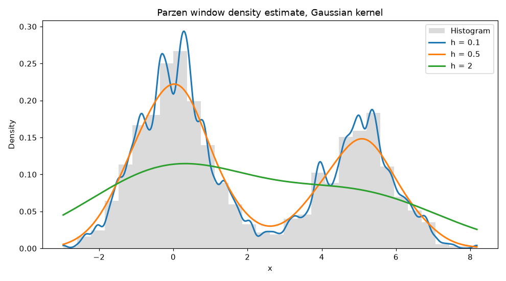

# Pattern Recognition

Classic pattern recognition methods written from scratch in Python for the Pattern Recognition lab course: a Gaussian Naive Bayes classifier, k-nearest neighbours, Parzen window density estimation, and Forgy and k-means clustering.



## Methods

| Script | Method | Data |
| --- | --- | --- |
| `naive_bayes.py` | Gaussian Naive Bayes: priors and per-class mean and standard deviation for each feature, then the most probable class. Prints each test flower's class probabilities and the accuracy. Asks for the training ratio. | `iris.csv` |
| `knn.py` | k-nearest neighbours with Euclidean distance and a majority vote, for k = 1, 3, 5, 7 and 9. Shows a confusion matrix for each k and accuracy against k. | `iris.csv` |
| `parzen.py` | Parzen window density estimate with a Gaussian kernel on a two-peak sample (60% N(0, 1), 40% N(5, 1)), for seven bandwidths and one of your choice. | generated |
| `forgy_kmeans.py` | Forgy (batch: assign every point, then move each centre to its cluster's mean, until nothing changes) and k-means (online: update a centre as each point joins). Compares the within-cluster sum of squares for three values of k. | `clustering_data.csv` |

On a 50/50 split of the iris data, k-nearest neighbours scores 97.3% for k = 1 and 3, 94.7% for k = 5 and 7, and 96.0% for k = 9.

## Run

Python 3.10 or later.

```bash
python -m venv .venv
source .venv/bin/activate      # Windows: .venv\Scripts\activate
pip install -r requirements.txt
python knn.py
```

The scripts find the CSV files next to themselves, so they run from any folder.

## Tests

```bash
pip install -r requirements-dev.txt
python -m pytest
```

11 tests check each method on small hand-made examples and on the real data: Naive Bayes accuracy counting and probabilities, KNN voting and accuracy on iris, that the Parzen estimate integrates to 1 and peaks at the two means, and that both clustering methods find obvious groups and fit better with more clusters. GitHub Actions runs them on every push.
